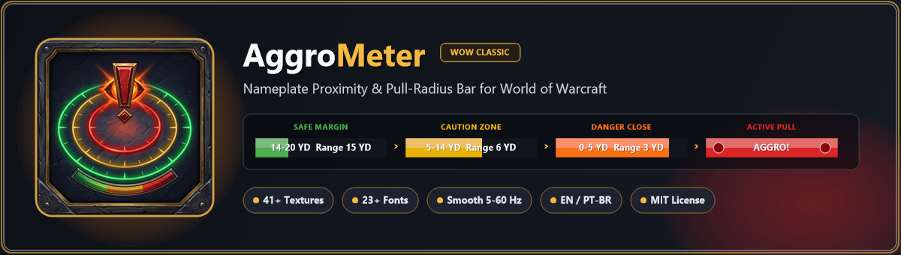
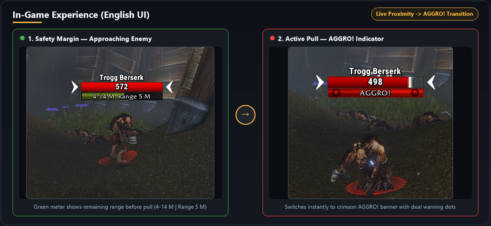
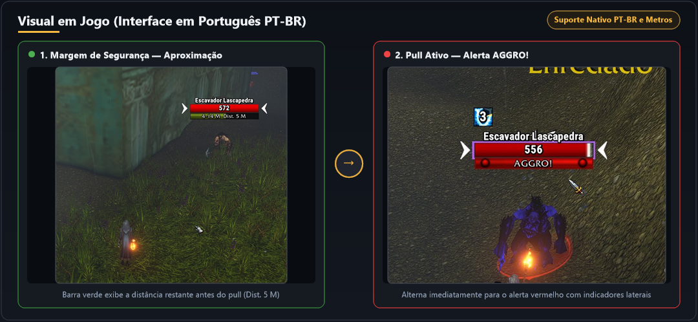
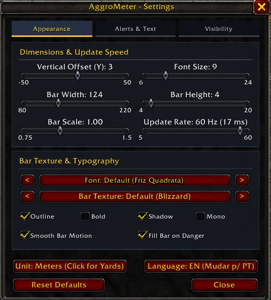

**AggroMeter** attaches a sleek, real-time proximity and pull-margin bar to hostile enemy nameplates—helping you judge safe movement space, avoid accidental body pulls in Hardcore runs, navigate crowded camps, and sneak past enemies more reliably.

> **Important:** Make sure **Enemy Nameplates** are turned on in-game (`V` by default). Type `/am config`, visit **Options → AddOns → AggroMeter**, or Left-Click the custom AggroMeter radar icon on your minimap/screen to customize every detail.

---

## Why Use AggroMeter?

Enemy aggro radius is normally invisible and changes dynamically based on level differences and stealth state. **AggroMeter** turns that hidden mechanic into clear visual feedback directly on every nearby hostile nameplate:

* **Green** — Comfortable safety margin remaining.
* **Amber / Yellow** — Approaching the estimated pull threshold.
* **Red (`DANGER`)** — Right on or inside the estimated aggro radius.

This makes it especially useful for **Hardcore characters**, **Rogues & Druids** sneaking through dense camps or caves, and players navigating higher-level zones.

---

## Visual Showcase

### Real-Time Proximity -> Pull Transition (English)

### Native Portuguese (PT-BR) & Metric Display

### Full In-Game Configuration UI (`/am config`)

3 dedicated tabs (**Appearance**, **Alerts & Text**, **Visibility**), live slider controls, `LibSharedMedia-3.0` texture & font pickers, one-click **Meters / Yards** toggle, and instant **EN / PT-BR** language switching:

---

## Key Features

### Real-Time Proximity & Pull Estimation
* **Level-Scaled Pull Radius:** Adjusts estimated detection range according to player-vs-mob level differences (plus per-NPC override support by NPC ID).
* **Rogue Stealth & Druid Prowl Mode:** Automatically switches to a tighter stealth detection estimate whenever Stealth or Prowl is active, and flashes a crimson **`!`** pre-detection alert using native WoW audio cues as you cross into danger range.
* **Unit-Aware & Bilingual Proximity Alerts:** Shows an optional target proximity countdown banner (`5 yd / 5 m`) matching your chosen units and language, plus center-screen **`AGGRO! - Mob Name`** pull alerts (suppressed automatically while dead or a ghost).
* **Zero-Allocation Polling & Reload Scan:** Scans visible nameplates immediately after login or `/reload` and updates at **5–60 Hz** without per-tick memory allocation overhead.

### Full Visual Customization & Live Preview (`/am config`)
* **Interactive Live Preview Card:** See every change immediately on a sample enemy nameplate inside the **Appearance** tab—click the preview bar to cycle **SAFE → CAUTION → DANGER → AGGRO!**.
* **3-Tab Configuration GUI + Blizzard Options Integration:** Organized into **Appearance**, **Alerts & Text**, and **Visibility** tabs with hover tooltips, a complete **Reset Defaults** button, and an entry in **Esc → Options → AddOns → AggroMeter**.
* **41+ Bar Textures & 23+ Fonts (`LibSharedMedia-3.0`):** Interactive preview dropdown grids and `<` / `>` cyclers importing both **fonts** and **statusbar textures** from `LibSharedMedia-3.0`, plus independent **Outline**, **Bold** (`THICKOUTLINE`), **Shadow**, and **Mono** text flags.
* **Position, Opacity, Compact Text & Motion Controls:** Anchor the bar **Below** or **Above** the nameplate, dial in **25%–100% Opacity**, enable **Compact Text (Margin Only)**, toggle **Smooth Bar Motion**, or enable **Fill Bar on Danger**.
* **Custom In-Game Icon & Addon Compartment:** Displays custom AggroMeter artwork in the WoW AddOns screen, Addon Compartment dropdown, circular-masked minimap button, and draggable floating quick-access button (`Left-Click`: Settings, `Right-Click`: Enable/Disable).

### Smart Combat, Group & Audio Controls
* **Nameplate `AGGRO!` Indicator + Group Retention:** Temporarily flashes red indicators and `AGGRO!` on newly pulled nameplates, or enable **Keep `AGGRO!` on Bar in Group** to keep that mob marked clearly while targeting you in party/raid.
* **Combat Hide Filters & Focus:** Independently hide proximity bars on mobs already fighting **you**, **your party/raid**, or **other players**; keep your **target / mouseover / DANGER** mobs at full opacity while dimming others to 55%; and hide distant safe mobs.
* **Test Alert Buttons & Native Audio Option:** Preview proximity warnings or the stealth `!` cue safely inside Settings (**`Test Alert & Sound`** / **`Test Stealth Cue (!)`**), and choose between bundled tones or **Use WoW Native Sounds Only**.
* **Meters (`M`) / Yards (`yd`) & Bilingual UI (`EN` / `PT-BR`):** Switch units and language anytime from Settings or slash commands.

---

## Important Note on Accuracy

World of Warcraft does not expose raw world coordinates or exact NPC aggro radii to addons. **AggroMeter** estimates distance brackets using legal client item, spell, and interaction range checks combined with level-difference and stealth heuristics. Treat the bar as an extra situational-awareness buffer—especially on Hardcore characters or near patrols, social-aggro packs, and bosses.

---

## Quick Slash Commands (`/am` or `/aggrometer`)

Type `/am config` to open Settings, `/am pos [below|above]` to anchor above/below, `/am alpha <0.25-1.00>` for opacity, `/am compact` for margin-only text, `/am unit` for Meters/Yards, `/am lang` for EN/PT-BR, `/am test` to test alerts, or `/am help` for all commands.

---

## License, Inspiration & Notices

* **License:** **MIT License** (`Copyright (c) 2026 Mynou`).
* **Visual Inspiration:** Nameplate bar styling and typography curation were visually inspired by **Platynator** (by *plusmouse*) alongside the community `LibSharedMedia-3.0` ecosystem.
* **Third-Party Data & Assets:** Distance-range item data derives from **LibRangeCheck-3.0** (MIT License); bundled fonts originate from open-source font libraries (`SIL OFL 1.1` / `Apache 2.0`). This addon is strictly free and non-commercial under Blizzard's AddOn policy, with no ownership claimed over third-party assets. See `THIRD_PARTY_NOTICES.txt` or [GitHub Issues](https://github.com/Mynoush/AggroMeter/issues) for notices and rights-holder contact.
