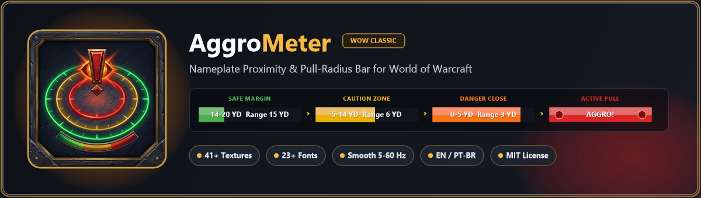
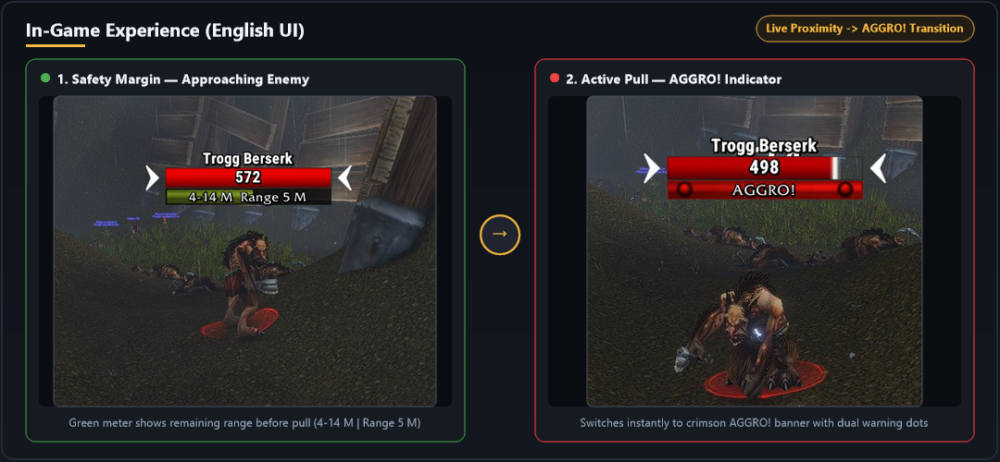
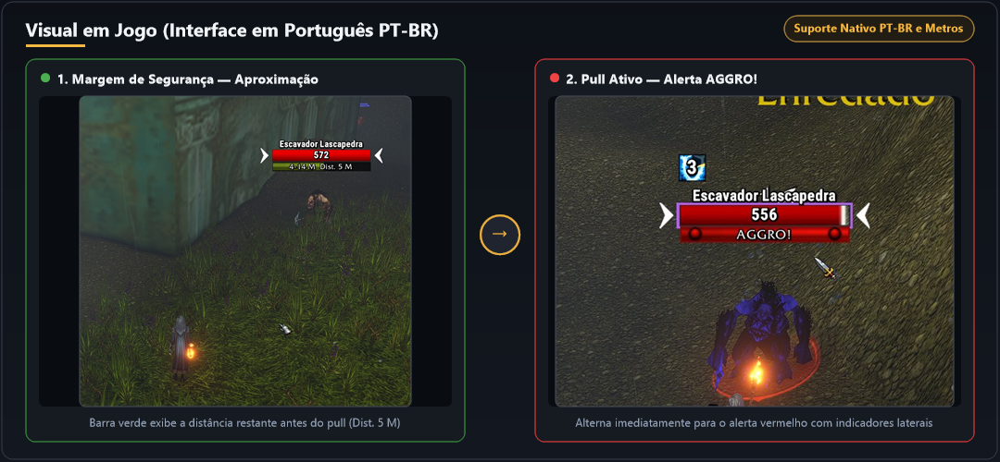
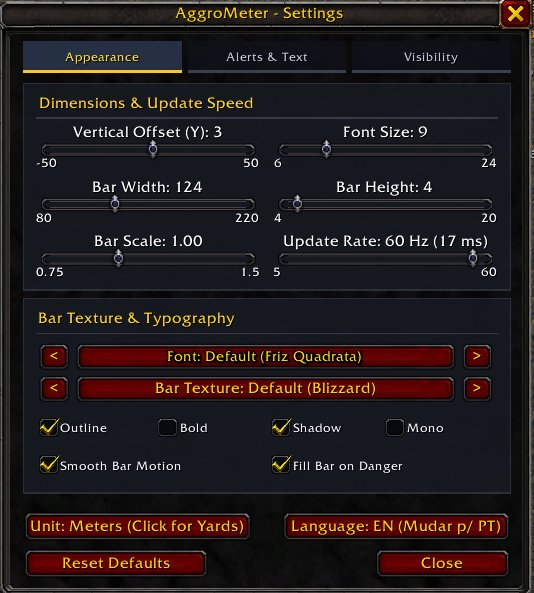

# AggroMeter

**Nameplate Proximity & Pull-Radius Bar for World of Warcraft**

**AggroMeter** attaches a sleek, customizable safety-margin bar to hostile enemy nameplates with zero per-frame table allocations. Instead of guessing how close you can walk before pulling a mob—or accidentally body-pulling extra packs in Hardcore, caves, or crowded quest hubs—AggroMeter turns invisible aggro radii into clear visual distance feedback in real time.

---

## Core Features

- **Real-Time Nameplate Proximity Bars (Zero-GC Update Loop):** Displays remaining safety distance and estimated pull radius below or above hostile enemy nameplates using progressive **Green → Amber → Red** transitions, plus immediate scanning of visible nameplates on login and `/reload`.
- **Level-Scaled & Stealth-Aware Estimation:** Automatically adjusts estimated pull distance based on level differences between you and each enemy, and switches to a tighter detection estimate while Rogues are in **Stealth** or Druids are in **Prowl**.
- **Live Preview & Full In-Game Settings (`/am config` or Options → AddOns → AggroMeter):**
  - **Interactive Live Preview:** Real-time nameplate preview card in the **Appearance** tab (click to cycle `SAFE → CAUTION → DANGER → AGGRO!`).
  - Clean 3-tab interface (**Appearance**, **Alerts & Text**, **Visibility**) with hover tooltips and complete **Reset Defaults** support.
- **41+ Bar Textures & 23+ Fonts (`LibSharedMedia-3.0`):** Interactive grid-dropdown menus with live visual previews, `<` / `>` quick cyclers, full **`LibSharedMedia-3.0`** import for both **fonts** and **statusbar textures**, and independent **Outline**, **Bold** (`THICKOUTLINE`), **Shadow**, and **Mono** text flags.
- **Smooth Motion, Opacity & Anchor Control:** Smoothly interpolates bar fill and color changes at **5–60 Hz** (default `25 Hz`), supports **Fill Bar on Danger** (inverted fill), **Below / Above Nameplate** positioning, **25%–100%** bar opacity, and **Compact Text** (margin-only) mode.
- **Proximity Alerts, Pull Flashes & Built-In Test Buttons:**
  - Unit-aware and localized target proximity warning banner (`5 yd / 5 m`) with optional WoW native SoundKit playback (**Use WoW Native Sounds Only**) or tiered alert chimes.
  - Center-screen pull alert (`AGGRO! - Mob Name`) plus flashing red nameplate pull indicator and **Keep `AGGRO!` on Bar in Group**.
  - **Stealth Pre-Detection Cue (`!`):** Flashes a crimson `!` with native WoW client alert sound upon crossing into stealth detection range.
  - Includes **`Test Alert & Sound`** and **`Test Stealth Cue (!)`** preview buttons inside Settings; automatically suppresses real combat alerts while dead or a ghost.
- **Custom Icon, Minimap Ring Mask & Floating Toggle:** Features a custom Warcraft-styled icon across the AddOns list, Addon Compartment menu, circular-masked minimap button, and draggable floating quick-access button (`Left-Click`: Config, `Right-Click`: Enable/Disable).
- **Smart Combat & Screen Declutter Filters:** Independently hide bars on mobs in combat with **you**, **your group/raid**, or **other players**; focus on **target / mouseover / DANGER** (`55%` dim on others); and hide distant safe mobs.
- **Instant Yards (`yd`) / Meters (`M`) & Bilingual UI (`EN` / `PT-BR`):** Switch units and interface language anytime from `/am config` or slash commands.

---

## Accuracy Note

World of Warcraft addons do not receive exact coordinates or raw server-side aggro radii for hostile units. **AggroMeter** calculates safe-margin brackets dynamically from Blizzard's legal item, spell, and interaction distance checks paired with level-difference and stealth heuristics. Treat the display as an informational safety margin—especially on **Hardcore** characters, patrols, social pulls, or scripted NPCs with special truesight/abilities.

---

## Visual Showcase

### Real-Time Proximity & Pull Transition (English UI)

### Native Portuguese (PT-BR) & Metric Display

### Full In-Game Configuration UI (`/am config`)

3 dedicated tabs (**Appearance**, **Alerts & Text**, **Visibility**), live slider controls, `LibSharedMedia-3.0` texture and font pickers, one-click **Meters / Yards** toggle, and instant **EN / PT-BR** localization switching:

---

## Installation

1. Ensure **Enemy Nameplates** are enabled in-game (default keybind: `V`).
2. Extract or place the `AggroMeter` folder into `World of Warcraft\_...\Interface\AddOns\AggroMeter\`.
3. Type `/am config`, open **Esc → Options → AddOns → AggroMeter**, or **Left-Click** the AggroMeter icon on your minimap/screen to customize.

---

## Slash Commands (`/am` or `/aggrometer`)

| Command | Description |
| :--- | :--- |
| `/am config` *(or `ui`, `menu`, `options`)* | Open or close the Settings window |
| `/am on` / `/am off` | Enable or disable AggroMeter |
| `/am unit [meters\|yards]` | Switch readout and alerts between **Meters (`M`)** and **Yards (`yd`)** |
| `/am lang [en\|pt]` | Switch menus, alerts, and bar labels between **English** and **Portuguese** |
| `/am text` | Toggle distance text inside nameplate bars |
| `/am compact [on\|off]` | Toggle margin-only compact bar text |
| `/am status [on\|off]` | Toggle `SAFE` / `CAUTION` / `DANGER` prefix before distance |
| `/am pos [below\|above]` | Anchor the bar below or above the enemy nameplate |
| `/am alpha <0.25-1.00>` | Set bar opacity (`0.25` to `1.00`) |
| `/am warning [on\|off]` | Toggle 5 m / 5 yd target proximity countdown banner |
| `/am alerts [all\|icon\|off]` | Cycle alert mode (`all`, `icon`, `off`) |
| `/am sound [on\|off]` | Toggle warning sound cues |
| `/am nativesound [on\|off]` | Use built-in WoW SoundKits only |
| `/am test [stealth]` | Preview the center proximity banner + audio (or stealth `!` cue) |
| `/am pullalert [on\|off]` | Toggle center-screen `AGGRO!` pull banner |
| `/am stealthnotice [on\|off]` | Toggle Rogue/Druid stealth red `!` detection alert |
| `/am scale <0.75-1.50>` | Set bar widget scale |
| `/am width <80-220>` | Set bar width in pixels |
| `/am height <4-20>` | Set bar height in pixels |
| `/am offsety <-50 to 50>` | Set vertical bar offset relative to the nameplate |
| `/am fontsize <6-24>` | Set bar font size |
| `/am font <friz\|arial\|morpheus\|skurri\|2002\|2002b\|friends\|nimrod\|path>` | Set bar font |
| `/am rate <5-60>` | Set update frequency in Hz (default `25`) |
| `/am invert [on\|off]` | Toggle Fill Bar on Danger mode |
| `/am smooth [on\|off]` | Toggle smooth fill & color animation |
| `/am dim [on\|off]` | Toggle Focus on Target (dims non-target safe bars to 55%) |
| `/am hidefar [on\|off]` | Toggle hiding bars on distant safe mobs |
| `/am hideself [on\|off]` | Hide bar on mobs already fighting you/your pet |
| `/am hidegroup [on\|off]` | Hide bar on mobs already fighting your party/raid |
| `/am hideother [on\|off]` | Hide bar on mobs tapped/pulled by players outside your group |
| `/am keepaggro [on\|off]` | Keep red `AGGRO!` indicator active in party/raid while mob targets you |
| `/am debug` / `/am reload` | Print target range diagnostics or refresh spell/item range tables |

---

## License, Inspiration & Third-Party Notices

- **License:** Released under the **MIT License** (`Copyright (c) 2026 Mynou`). See `LICENSE`.
- **Visual Inspiration:** Nameplate bar styling aesthetics and typography choices were visually inspired by **Platynator** (by *plusmouse*) and the World of Warcraft `LibSharedMedia-3.0` community ecosystem.
- **Distance-Range Item Data:** Derived from [LibRangeCheck-3.0](https://github.com/WeakAuras/LibRangeCheck-3.0) by The WoWUIDev Community (MIT License).
- **Fonts, Media & Rights-Holder Notice:** Bundled fonts come from open-source font libraries (`SIL OFL 1.1` / `Apache 2.0`), and stealth detection cues play native WoW client SoundKits. AggroMeter is free and non-commercial under Blizzard Entertainment's AddOn policy; no ownership is claimed over third-party assets or trademarks. Full notices and the takedown contact procedure are in `THIRD_PARTY_NOTICES.txt` (or via [GitHub Issues](https://github.com/Mynoush/AggroMeter/issues)).
